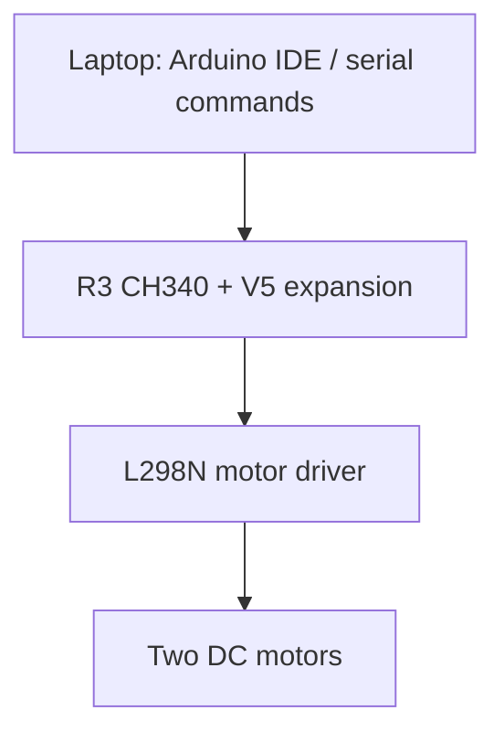
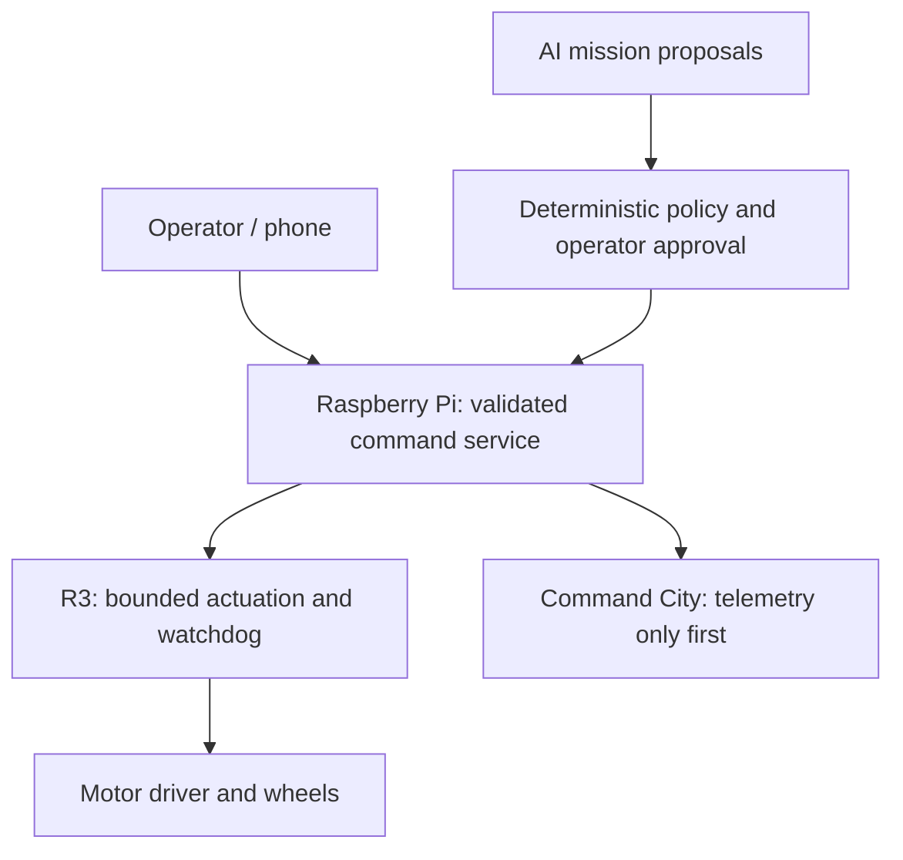

# JVMBOT

**A miniature robotics operations and security lab, built one verified milestone at a time.**

JVMBOT is a personal engineering portfolio by **JamScripts / JVMM3R**. It starts with a LAFVIN two-wheel robot and grows toward a Raspberry Pi managed platform with diagnostics, controlled commands, telemetry, and documented recovery.

**Current checkpoint:** the assembled robot accepts serial movement commands from a laptop. The builder has reported successful uploads, both wheels spinning, and working keyboard control. The exact running sketch and raw test recordings still need to be archived here.

**Next checkpoint:** preserve the working firmware and evidence before changing the robot, then prove a supervised Raspberry Pi-to-Arduino USB connection.

## What works and what is planned

| Capability | Status | Evidence |
| --- | --- | --- |
| Chassis assembly and wiring | Builder-confirmed | [Progress ledger](docs/PROGRESS.md) |
| R3 firmware upload | Builder-confirmed | Arduino IDE reported “Done Uploading” |
| Both motors turning | Builder-confirmed | Builder reported both wheels spinning |
| Serial keyboard movement | Builder-confirmed | Builder reported the command exercise worked |
| Raspberry Pi foundation and software prototypes | Historical record | [Source and evidence limits](docs/EVIDENCE.md); source/tests not yet imported |
| Pi-to-R3 physical control | Planned | USB discovery, bounded commands, and link-loss tests required |
| Phone control / Command City telemetry | Planned | Authentication, stale-state handling, and real-device tests required |
| Autonomous navigation / AI control / JVMGuard enforcement on robot | Planned | No operational claim yet |

“Builder-confirmed” means reported by the person performing the physical test. It is distinct from a reproducible test attached to an exact code revision.

## Architecture

### Current physical baseline

### Target architecture — planned

The AI proposes; deterministic controls authorize. A dashboard is not an independent motor writer. Motor-side stop behavior must work even when the Pi process or network fails. The initial Command City integration remains telemetry only.

## Explore the portfolio

- [Progress and completed checkpoints](docs/PROGRESS.md)
- [Roadmap and acceptance criteria](ROADMAP.md)
- [Hardware inventory and wiring verification](hardware/README.md)
- [Upload troubleshooting case study](docs/runbooks/ARDUINO_UPLOAD.md)
- [Test plan and evidence rules](docs/TEST_PLAN.md)
- [Architecture decisions](docs/ARCHITECTURE.md)
- [Next lab: Raspberry Pi USB discovery](docs/runbooks/PI_USB_CHECKPOINT.md)
- [3D enclosure design brief](hardware/cad/README.md)
- [Career evidence and honest interview points](docs/PORTFOLIO.md)
- [How to record future work](CONTRIBUTING.md)

## Repository layout

| Path | Purpose |
| --- | --- |
| `firmware/` | Exact Arduino sketches, once recovered and verified |
| `pi/` | Future Pi software and deployment instructions |
| `hardware/` | Inventory, wiring records, enclosure measurements and CAD |
| `docs/` | Progress, architecture, runbooks, tests and evidence |
| `media/` | Sanitized physical demo photos and video references |
| `tracking/` | Initial issue backlog and milestone definitions |

There is no runnable firmware or Pi controller in this initial documentation baseline. Empty subsystem folders have explicit recovery tasks; generated replacements are not presented as the historical working code.

## Working method

Keep one active hardware checkpoint. Preserve the working version, change one thing, test the expected result and a relevant failure, then attach evidence and close the issue. Track work through [GitHub issues](https://github.com/JamScripts/JVMBOT/issues) and [the issue index](tracking/README.md). Planned board statuses are **Backlog → Next Up → In Progress → Completed**; the native board is pending setup.

This is an educational platform under active development. Autonomous commercial capability, safety certification, measured odometry, and job readiness are not implied by a kit assembly or a planned feature.

Documentation baseline: **2026-11-01**. See [CHANGELOG.md](CHANGELOG.md).
